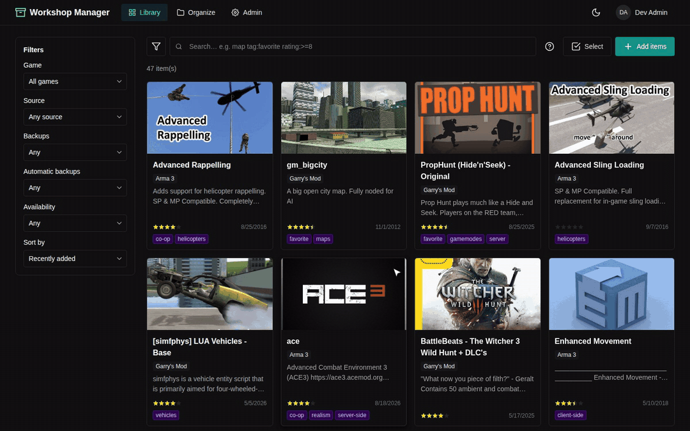

# Workshop Manager

A self-hosted library for game mods. It keeps track of the mods you use and can save copies of their files. Mods come
from the Steam Workshop for now; other sources can be added later.



Mods change all the time. Sometimes an author removes an item, or an update breaks the save you were playing. With
your own copy of the files and your notes in one place, you can go back to the version that worked.

## Features

- Add mods by link or ID, up to 500 at once. The items they require can be added in the same step.
- Write your own notes, change titles and descriptions, rate items and sort them with tags and groups for each game.
- Link items to each other: one requires another, is a parent of it, or is an alternative to it.
- Back up mod files to your own storage. Backups can repeat after every update, and you choose how many versions to
  keep.
- Keep local mods too: upload the files of mods that aren't published anywhere.
- Details, previews and screenshots are saved too, so an item removed from its source still shows everything you had.
- Search with short filters, for example `tag:maps rating:>=8 updated:>month`.
- Sign in with a password or with Steam. Admins manage users and their permissions, games and background jobs.

## How it works

The backend is a Spring Boot application with a REST API. Each mod source is a "modspace" with its own adapter: it
checks item IDs, reads item details and finds dependencies, while the rest of the app treats every source the same
way. Downloading files is the source-specific part. For the Steam Workshop, the backend drives SteamCMD, Steam's
command-line client, which runs in its own container.

Files and images go to S3-compatible storage (SeaweedFS here). Work that takes time, like keeping items in sync with
their source, downloads and cleanup, runs as scheduled background jobs. The frontend is a React app, built into the
same jar. In production the app and everything around it run as Docker containers.

- **Backend:** Java 25, Spring Boot 4, Spring Security with JWT, Hibernate, PostgreSQL, Liquibase, Redis, Quartz,
  ANTLR for the search language, Resilience4j and Bucket4j to keep calls to outside services within limits
- **Frontend:** React 19, TypeScript, Vite, Chakra UI, TanStack Query, Redux Toolkit
- **Infrastructure:** Docker Compose, SeaweedFS, SteamCMD, nginx, Prometheus and Grafana

## Running it locally

You need Docker, Java 25 and Node.js 24.

```bash
cd backend
sh ./gradlew dockerComposeUp
sh ./gradlew bootRun
```

This starts PostgreSQL, Redis, SeaweedFS, SteamCMD, Prometheus and Grafana in Docker, then the backend on port 8080.
In a second terminal:

```bash
cd frontend
npm install
npm run dev
```

Open <http://localhost:3000> and sign in as `admin` with the password `Admin123!dev`. This account is created on the
first start, while the database is empty. Grafana is on <http://localhost:3101>.

Good to know:

- A Steam Web API key in `backend/.env` (`STEAM_WEB_API_KEY=...`) adds dependencies, votes, author names and
  unlisted items. Without it the rest still works.
- `docker compose -f compose.dev.yaml --profile seed run --rm seed` (in `backend/`) fills the database with test data:
  several users, made-up games and items. See [backend/dev/seed](backend/dev/seed/README.md).
- [showcase](showcase/README.md) runs a separate instance with real Workshop items and records the GIF above.
- `sh ./gradlew test` runs the backend tests.

## Self-hosting

Everything runs with Docker Compose, the app included.

1. Copy `backend/.env.example` to `backend/.env` and fill it in. Each value is explained there. For `APP_IMAGE` and
   `STEAMCMD_IMAGE`, any names work, for example `workshop-manager:local` and `workshop-manager-steamcmd:local`:
   Docker gives these names to the images you build in the next step.
2. In `backend/`, build the images and start everything:

   ```bash
   docker compose build
   docker compose up -d
   ```

This runs the app with PostgreSQL, Redis, SeaweedFS, SteamCMD, Prometheus, Grafana and nginx. nginx serves the app
over HTTPS on your domain, so the certificate files have to be in the folder set in `TLS_CERT_DIR` (for example from
Let's Encrypt with certbot).

To set up a fresh Debian 13 server and deploy to it with GitHub Actions instead, see
[backend/deploy](backend/deploy/README.md).

## License

[MIT](LICENSE)
